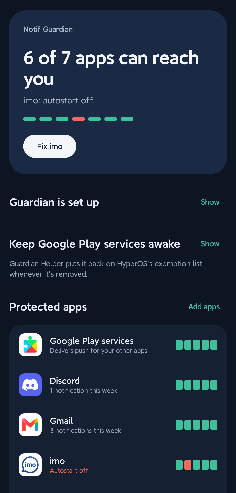
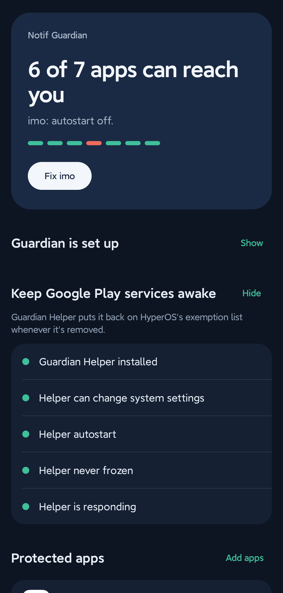
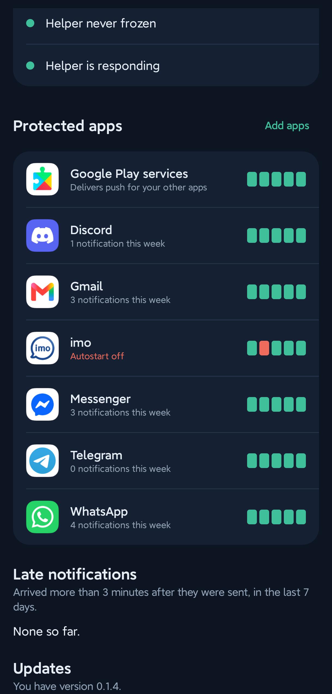

<div align="center">


# Notif Guardian

**Real-time notifications on Xiaomi HyperOS, without opening the app first.**

Stops HyperOS from freezing Google Play services, so WhatsApp, Telegram, Gmail and every other push
arrives when it's sent, not when you unlock the phone.

[](../../releases/latest)
[](../../releases)
[](../../stargazers)
[](#license)


[**Download**](../../releases/latest) · [**Website**](https://mahir-hs.github.io/notif-guardian/) · [Changelog](CHANGELOG.md) · [FAQ](#faq) · [Troubleshooting](#troubleshooting)

</div>

---

## Screenshots

<div align="center">
<table>
  <tr>
    <td align="center"><br><sub><b>One-glance status</b><br>and a fix button for what's broken</sub></td>
    <td align="center"><br><sub><b>Keep Google Play services awake</b><br>the helper's setup checklist</sub></td>
    <td align="center"><br><sub><b>Per-app health</b><br>five checks each, plus late-notification log</sub></td>
  </tr>
</table>
</div>

<sub>Real screenshots from a Redmi Note 14 Pro+ running HyperOS 3.</sub>

## The problem

On Xiaomi phones, messages often show up only when you unlock the screen or open the app. Notif
Guardian finds out why, fixes what it can, and tells you when something breaks again.

<details>
<summary><b>Why does this happen on HyperOS? (the technical version)</b></summary>

<br>

Almost every app gets push notifications through one connection held open by **Google Play
services** (Firebase Cloud Messaging, FCM). HyperOS has its own process freezer, **Millet**, that
freezes background apps when the screen turns off. It ignores Android's normal battery whitelists
and only leaves alone the apps in a hidden list (`MILLET_NO_RESTRICT_APP`).

Setting an app's **Battery saver** to **No restrictions** puts it on that list. But:

- Google Play services is a system app, so HyperOS offers **no battery saver setting for it**. It
  gets frozen whenever the screen is off, and push stops for every app until you unlock.
- HyperOS **rebuilds the list** whenever any app's battery saver changes, dropping anything it
  didn't put there itself.

You can see it yourself: `adb shell dumpsys greezer` shows Google Play services (`uid 10xxx`)
frozen right after `SCREEN OFF`.

</details>

## Features

| | |
|---|---|
| 🛡️ **Per-app protection checks** | Running, autostart, battery saver, background activity, and "not frozen with the screen off" for each app you pick. |
| 🔧 **One-tap fixes** | Opens the exact HyperOS settings screen for each problem. |
| ♻️ **Keeps Google Play services exempt** | Guardian Helper puts it back on HyperOS's exemption list within milliseconds of HyperOS removing it. |
| 🚨 **Force-stop alerts** | Tells you when the system kills a protected app, with a tap to revive it. |
| ⏱️ **Late-notification log** | Measures time sent vs. time shown and lists the late ones. |
| 📦 **Diagnostics export** | A zip of logs and settings state (never message content) for bug reports. |
| 🔄 **Self-updating** | Updates from this repo's releases with progress; only genuine releases (same signing key) install. |
| 🔒 **Private** | No analytics, no accounts. Reads *when* a notification was posted, never its text. |

## Supported devices

| Status | Devices |
|---|---|
| ✅ **Tested** | Redmi Note 14 Pro+ · HyperOS 3.0 (Android 15) |
| 🟡 **Expected to work** | Other Xiaomi, Redmi and POCO phones on **HyperOS 1, 2 and 3**: they share the same Millet freezer (untested) |
| ❓ **Unknown** | **MIUI 12-14** phones: the freezer and settings screens differ, so some checks may be wrong |
| ❌ **Not supported yet** | Other brands (OPPO, Vivo, Huawei, Realme, OnePlus, Samsung): planned later |

Requires Android 11 or newer. Not sure about your phone? Install it and use **Share diagnostics**;
reports from other models help make this list longer. Open an [issue](../../issues) with the model
and ROM version.

## Install

1. Download `NotifGuardian-x.y.z.apk` from the [**latest release**](../../releases/latest), on the
   phone.
2. Install **Notif Guardian** like any download and open it.
3. Work through **Guardian is set up**, then tap **Add apps** and pick the apps that matter to you.
4. Install **Guardian Helper** (inside Guardian: **Keep Google Play services awake → Install**) and
   turn every row green.

<details>
<summary><b>Step 3 in detail: Notif Guardian setup</b></summary>

<br>

1. **Notification access**: lets it measure delays. If Android blocks it because the app "comes
   from an unknown source", open Guardian's **App info → ⋮ → Allow restricted settings**, then try
   again. Android asks this once for any app installed from a downloaded file (Android 13+).
2. **Guardian's alerts**: allow notifications.
3. **No battery restrictions**, **Autostart**, and **Not frozen when the screen is off**: each row
   opens the right HyperOS screen. Set Battery saver to **No restrictions**.

</details>

<details>
<summary><b>Step 4 in detail: Guardian Helper (needed for Google Play services)</b></summary>

<br>

Guardian Helper is a tiny companion with no screen. Android only lets apps built for Android 5.1 or
older write HyperOS's hidden list, so the helper targets that version and does exactly one thing:
add packages to the list when Guardian asks. Only apps signed with the same key as Guardian can ask
it, and it has no internet permission.

1. Install it on the phone (or download `GuardianHelper-x.y.z.apk` from the release). It has no
   icon. HyperOS's installer accepts it (tested on HyperOS 3), even though stock Android 14+ refuses
   apps built for old Android versions.
2. **Only if your phone refuses to install it:** install once from a computer with
   [adb](https://developer.android.com/tools/releases/platform-tools). Turn on **USB debugging** and
   **Install via USB** in Developer options (Xiaomi requires a Mi account for this), then run
   ```
   adb install --bypass-low-target-sdk-block GuardianHelper-x.y.z.apk
   ```
   and tap **Install** on the phone's confirmation screen.
3. In Guardian, open **Keep Google Play services awake** and turn every row green:
   - **Helper can change system settings**: turn on **Modify system settings**.
   - **Helper autostart**: turn it on.
   - **Helper never frozen**: set its battery saver to **No restrictions**.
   - **Helper is responding**: tap **Open helper**, confirm Android's one-time permission review,
     then **Test helper**.

HyperOS turns the helper's autostart off again whenever the helper is updated; the section shows it
in red if that happens.

</details>

## FAQ

<details>
<summary><b>Why are my notifications delayed until I unlock the phone?</b></summary>

<br>

HyperOS froze the app, or the Google Play services process that delivers its push, when the screen
went off. Notifications queue up and arrive when the process thaws on unlock. See
[the technical version](#the-problem) above. Guardian shows which of the five checks is failing for
each app.
</details>

<details>
<summary><b>Does this fix FCM (Firebase Cloud Messaging) delays?</b></summary>

<br>

It fixes the common cause on HyperOS: the phone freezing the process that holds the FCM
connection. It can't fix problems outside the phone, such as a router that drops idle connections
or an app server that sends late. Dial `*#*#426#*#*` to open Google's FCM diagnostics and see
whether the push connection is up.
</details>

<details>
<summary><b>I set Battery saver to "No restrictions" already. Why isn't that enough?</b></summary>

<br>

That only covers the app itself. Almost every app's push goes through Google Play services, which
has no such setting on HyperOS and is frozen anyway. HyperOS also rebuilds the exemption list on
any change and drops entries it didn't add. Guardian Helper puts Google Play services back each time.
</details>

<details>
<summary><b>Is it safe? What does it read?</b></summary>

<br>

Guardian reads notification timing (which app posted, and when), never the text. It goes online
only when you tap **Check for updates**, and only to GitHub. Nothing leaves the phone unless you share a diagnostics file yourself. Guardian
Helper has no internet permission. The code is MIT-licensed and open here.
</details>

<details>
<summary><b>Why does Telegram still sometimes arrive late?</b></summary>

<br>

Telegram may delay pushes on purpose while you're active on Telegram Desktop or Web. That happens on
Telegram's servers; the phone delivers the push the moment it arrives.
</details>

## Troubleshooting

| Symptom | Fix |
|---|---|
| Android blocks **Notification access** ("restricted setting") | Guardian's **App info → ⋮ → Allow restricted settings**, then retry. |
| A row for an app is red | Tap **Fix** on the home card; it opens the exact settings screen. |
| **Helper autostart** turned red after an update | HyperOS resets it on every helper update. Turn autostart back on. |
| Helper won't install | Use the adb command in Step 4 (`--bypass-low-target-sdk-block`). |
| **Helper is responding** never goes green | Tap **Open helper** and confirm the permission review, then reinstall Guardian once so the signature permission is granted. |
| Notifications still late | **Lock the app in Recents** (long-press the card, tap the lock) so "Clear all" doesn't kill it, then check the late-notification log. |
| Update fails with a signature error | You're switching between debug and release builds. Uninstall both apps once, then install from the release. |
| Still stuck | Tap **Share diagnostics** and attach the zip to an [issue](../../issues). |

To collect diagnostics from a computer instead, run `scripts/pull-diagnostics.ps1` (needs adb).

## Compatibility and known limitations

- **HyperOS only for now.** Other Chinese ROMs have their own freezers and are not handled yet.
- **Not a guarantee.** Guardian removes the freezer cause. It can't fix a bad network, a server-side
  delay, or an app with its own push bugs.
- **The helper needs a trick.** It targets Android 5.1 so it can write the hidden list, so some ROMs
  may refuse it without adb.
- **HyperOS resets some settings** (helper autostart on every helper update). Guardian flags this
  but can't change it for you.
- **Updates only cover Guardian.** Android doesn't let an app install the helper silently; Guardian
  offers it from the release when it changes.
- Only apps *you* add are checked, plus Google Play services, which is always included.

## Privacy

Guardian goes online only when you tap **Check for updates** (to read this repo's latest release
and download it), and only to GitHub. Guardian reads notification timing, never the text. Guardian Helper
has no internet permission at all.

## Building

Requirements: JDK 17+ and the Android SDK (platform 36).

```
./gradlew :app:assembleDebug :helper:assembleDebug
```

Release builds are signed with the key described in `keystore.properties` (not in the repo):

```
storeFile=/path/to/release.jks
storePassword=...
keyAlias=...
keyPassword=...
```

`scripts/build-release.ps1` builds both signed APKs into `dist/` with SHA-256 checksums. Without
`keystore.properties`, release builds fall back to the debug key. **Guardian and Guardian Helper
must be signed with the same key**, or Guardian can't call the helper.

`scripts/pull-diagnostics.ps1` collects logs and HyperOS state from a connected phone over adb.

The website lives in `docs/` and is served by GitHub Pages (Settings → Pages → Deploy from a
branch → `main`, folder `/docs`). Its download buttons always point at the latest release.

## Releasing

The in-app updater reads the latest release of the repo set in `gradle.properties`
(`updateRepo=owner/name`). For each release:

1. In `app/build.gradle.kts`, raise `versionCode` by one and set `versionName` (e.g. `0.2.0`).
   Add the version's section to `CHANGELOG.md`; it doubles as the release notes.
2. Run `scripts/build-release.ps1`.
3. Create a GitHub release with the tag `v` + versionName (e.g. `v0.2.0`) and attach **all three**
   files from `dist/`: `NotifGuardian-<version>.apk`, `GuardianHelper-<version>.apk` and
   `SHA256SUMS.txt`. The updater looks for an asset named `NotifGuardian-*.apk` and checks it
   against `SHA256SUMS.txt`. The release notes are shown in the app.

The updater only updates Guardian: Android doesn't let an app install the helper, because it
targets an old Android version. Guardian Helper rarely changes; when it does, users reinstall it
from the release like the first time (and turn its autostart back on).

## License

Released under the MIT License.

<details>
<summary><b>Read the full license text</b></summary>

```text
MIT License

Copyright (c) 2026 Notif Guardian contributors

Permission is hereby granted, free of charge, to any person obtaining a copy
of this software and associated documentation files (the "Software"), to deal
in the Software without restriction, including without limitation the rights
to use, copy, modify, merge, publish, distribute, sublicense, and/or sell
copies of the Software, and to permit persons to whom the Software is
furnished to do so, subject to the following conditions:

The above copyright notice and this permission notice shall be included in all
copies or substantial portions of the Software.

THE SOFTWARE IS PROVIDED "AS IS", WITHOUT WARRANTY OF ANY KIND, EXPRESS OR
IMPLIED, INCLUDING BUT NOT LIMITED TO THE WARRANTIES OF MERCHANTABILITY,
FITNESS FOR A PARTICULAR PURPOSE AND NONINFRINGEMENT. IN NO EVENT SHALL THE
AUTHORS OR COPYRIGHT HOLDERS BE LIABLE FOR ANY CLAIM, DAMAGES OR OTHER
LIABILITY, WHETHER IN AN ACTION OF CONTRACT, TORT OR OTHERWISE, ARISING FROM,
OUT OF OR IN CONNECTION WITH THE SOFTWARE OR THE USE OR OTHER DEALINGS IN THE
SOFTWARE.
```

</details>
